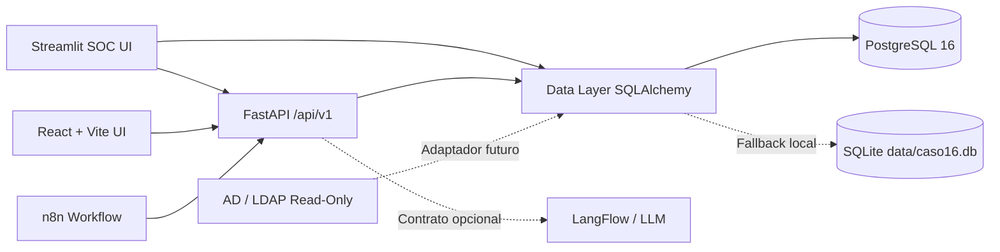

# 🛡️ CASO16 — Identity Risk AI

[](https://www.python.org/)
[](https://fastapi.tiangolo.com/)
[](https://streamlit.io/)
[](https://react.dev/)
[](https://www.postgresql.org/)
[](./LICENSE)

**Plataforma de detección determinista y gobierno de identidades para el descubrimiento de cuentas huérfanas, inactivas y privilegios excesivos.**

Este proyecto implementa un **MVP operacional auditable** diseñado para equipos SOC, administradores de seguridad y auditores de TI. Combina un motor determinista de evaluación de riesgo (reglas `R01`–`R06` y scoring `0–100`) con una consola interactiva en **Streamlit**, una API REST versionada en **FastAPI**, una interfaz alternativa en **React + TypeScript (Vite)** y contratos listos para orquestación con **n8n** y **LangFlow**.

---

## 📋 Tabla de Contenidos

- [Características Principales](#-características-principales)
- [Arquitectura del Sistema](#-arquitectura-del-sistema)
- [Motor de Reglas y Scoring](#-motor-de-reglas-y-scoring)
- [Estructura del Proyecto](#-estructura-del-proyecto)
- [Requisitos Previos](#-requisitos-previos)
- [Instalación y Ejecución Rápida](#-instalación-y-ejecución-rápida)
  - [Opción 1: Entorno Local (Python)](#opción-1-entorno-local-python)
  - [Opción 2: Docker Compose + PostgreSQL](#opción-2-docker-compose--postgresql)
  - [Opción 3: Frontend React (Vite)](#opción-3-frontend-react-vite)
- [Referencia de la API REST](#-referencia-de-la-api-rest)
- [Pruebas y Verificación](#-pruebas-y-verificación)
- [Seguridad, Alcance y Cumplimiento](#-seguridad-alcance-y-cumplimiento)
- [Licencia](#-licencia)

---

## ✨ Características Principales

- **Inventario Unificado de Identidades:** Ingesta sintética de cuentas de directorio (*Demo AD / Demo LDAP*) con atributos de actividad, roles privilegiados, vigencia de credenciales y estado de justificación.
- **Motor Determinista de Reglas (`R01`–`R06`):** Evaluación reproducible con distinción explícita entre evidencia **Confirmada** y **Potencial**, evitando falsas certezas.
- **Scoring de Riesgo (`0–100`):** Cálculo transparente basado en privilegios administrativos, antigüedad de inactividad, cuentas de servicio, expiración de contraseñas y revisiones pendientes.
- **Gestión del Ciclo de Vida de Hallazgos:** Flujo completo (*Detectado → En revisión → Remediado / Excepción / Cerrado*) con asignación de responsable y comentarios.
- **Bitácora de Auditoría Inmutable (*Append-Only*):** Registro trazable de cada ejecución de escaneo, cambio de estado y acción administrativa con fecha/hora UTC, actor y rol.
- **Exportación Ejecutiva Multiformato:** Generación nativa de reportes de auditoría en **Excel (`.xlsx`)**, **Word (`.docx`)** y **PDF (`.pdf`)**.
- **Arquitectura Desacoplada:** API REST `/api/v1` documentada con OpenAPI y plantillas de integración para flujos de automatización (**n8n**) y explicación asistida por IA (**LangFlow**).

---

## 🏗️ Arquitectura del Sistema



> **Principio de diseño:** El motor determinista es la única fuente de verdad para las evidencias y el cálculo de score. Cualquier componente LLM (vía LangFlow) actúa únicamente como capa explicativa o de priorización, sin alterar la evidencia base ni recibir credenciales en texto plano.

---

## 🎯 Motor de Reglas y Scoring

| Código | Regla | Descripción | Severidad Base |
| :--- | :--- | :--- | :---: |
| **`R01`** | **Inactividad prolongada** | Cuenta sin actividad registrada durante 90 días o más, o sin fecha de último acceso. | Medio |
| **`R02`** | **Privilegio administrativo sin justificación** | Cuenta con privilegios de administrador (`is_admin`) sin respaldo documental verificado. | Alto |
| **`R03`** | **Cuenta administrativa duplicada** | Identidad administrativa potencialmente redundante asociada a un mismo operador. | Medio |
| **`R04`** | **Contraseña de servicio no expira** | Cuenta de tipo `service` configurada con contraseña sin caducidad (`password_never_expires`). | Alto |
| **`R05`** | **Privilegios inconsistentes** | Asignación de roles fuera de la política base permitida (`Domain Users`, `Helpdesk`, `ReadOnly`). | Crítico |
| **`R06`** | **Riesgo alto sin revisión** | Cuenta con puntaje de riesgo elevado (`score >= 60`) sin revisión reciente (`> 60 días` o nula). | Alto |

---

## 📂 Estructura del Proyecto

```text
caso16-identity-risk-ai/
├── app.py                      # Consola SOC interactiva en Streamlit
├── main.py                     # API REST versionada (/api/v1) con FastAPI
├── data_layer.py               # Modelo SQLAlchemy, motor de reglas, scoring, auditoría y reportes
├── requirements.txt            # Dependencias de Python
├── Dockerfile                  # Imagen de contenedor para backend y UI
├── docker-compose.yml          # Orquestación de PostgreSQL 16 + Streamlit + FastAPI
├── .env.example                # Plantilla de variables de entorno
├── automation_n8n_scan.json    # Flujo exportable para escaneos programados en n8n
├── langflow_flow.json          # Contrato de integración opcional con LangFlow
├── docs/
│   ├── ARCHITECTURE.md         # Detalle arquitectónico y modelo de datos
│   ├── LIMITATIONS.md          # Alcance del MVP y controles previos a producción
│   └── TRACEABILITY.md         # Matriz de trazabilidad de requerimientos
├── frontend/                   # Interfaz web en React 18 + TypeScript + Vite
│   ├── src/
│   │   ├── App.tsx             # Vista principal del dashboard SOC en React
│   │   ├── api.ts              # Cliente HTTP con degradación controlada (offline fallback)
│   │   ├── main.tsx            # Punto de entrada React
│   │   └── styles.css          # Estilos del panel operacional
│   ├── package.json
│   └── vite.config.ts
├── tests/
│   └── test_core.py            # Pruebas unitarias e integración del motor y API
├── test_smoke.py               # Smoke tests de base de datos, reglas y endpoints
├── test_reports.py             # Verificación de generación de reportes XLSX/DOCX/PDF
├── test_ui.py                  # Pruebas de renderizado de la interfaz Streamlit
└── LICENSE                     # Licencia MIT
```

---

## 🔧 Requisitos Previos

- **Python:** `3.11` o superior
- **Node.js:** `18+` *(opcional, solo para compilar o ejecutar el frontend en `frontend/`)*
- **Docker & Docker Compose:** *(opcional, para despliegue con PostgreSQL 16)*

---

## 🚀 Instalación y Ejecución Rápida

### Opción 1: Entorno Local (Python)

1. **Clonar el repositorio:**
   ```bash
   git clone https://github.com/Prolexis/caso16-identity-risk-ai.git
   cd caso16-identity-risk-ai
   ```

2. **Crear y activar el entorno virtual:**
   ```powershell
   # Windows (PowerShell)
   py -3.11 -m venv .venv
   .\.venv\Scripts\Activate.ps1
   ```
   ```bash
   # Linux / macOS
   python3 -m venv .venv
   source .venv/bin/activate
   ```

3. **Instalar dependencias:**
   ```bash
   pip install -r requirements.txt
   ```

4. **Iniciar la consola SOC (Streamlit):**
   ```bash
   streamlit run app.py --server.port 8501
   ```
   - Accede en tu navegador a: `http://localhost:8501`
   - **Usuarios de demostración:**
     - `analyst@demo.local` *(Analista de ciberseguridad)*
     - `security@demo.local` *(Administrador de seguridad)*
     - `auditor@demo.local` *(Auditor)*
   - **Contraseña:** `demo`

5. **Iniciar la API REST (FastAPI):**
   ```bash
   uvicorn main:app --host 0.0.0.0 --port 8000 --reload
   ```
   - Documentación interactiva (Swagger UI): `http://localhost:8000/docs`

---

### Opción 2: Docker Compose + PostgreSQL

Para levantar el stack completo (**PostgreSQL 16 + Streamlit + FastAPI**):

```bash
docker compose up --build
```

- **Consola Streamlit:** `http://localhost:8501`
- **API FastAPI:** `http://localhost:8000/docs`
- **Base de datos:** PostgreSQL 16 con persistencia en el volumen `caso16_pgdata`

---

### Opción 3: Frontend React (Vite)

El directorio `frontend/` incluye una SPA en React + TypeScript que consume la API de FastAPI (con soporte de fallback local si el backend no está disponible):

```bash
cd frontend
npm install
npm run dev
```

- Accede en: `http://localhost:5173`

---

## 🔌 Referencia de la API REST

Todos los endpoints están bajo el prefijo `/api/v1`:

| Método | Endpoint | Descripción |
| :---: | :--- | :--- |
| `GET` | `/api/v1/health` | Estado del servicio, motor de base de datos activo y conteo de registros. |
| `GET` | `/api/v1/dashboard` | KPIs operacionales (cuentas totales, inactivas, alto riesgo, hallazgos abiertos/cerrados). |
| `GET` | `/api/v1/accounts` | Lista paginada y filtrable (`?search=...&limit=100`) del inventario de identidades. |
| `GET` | `/api/v1/findings` | Lista de hallazgos filtrable por estado (`?status=Detectado`) y severidad (`?severity=Crítico`). |
| `POST` | `/api/v1/scans` | Ejecuta una corrida completa del motor determinista (`R01`–`R06`) y registra auditoría. |
| `PATCH` | `/api/v1/findings/{id}` | Actualiza el estado, responsable (`owner`) y comentario de un hallazgo con trazabilidad en `audit_logs`. |

**Ejemplo de ejecución de escaneo vía cURL:**

```bash
curl -X POST http://localhost:8000/api/v1/scans \
  -H "Content-Type: application/json" \
  -d '{"actor": "analyst@demo.local", "role": "Analista de ciberseguridad"}'
```

---

## 🧪 Pruebas y Verificación

El proyecto cuenta con pruebas automatizadas para validar el motor de reglas, la generación de reportes binarios (`XLSX`, `DOCX`, `PDF`), la API y la interfaz:

```bash
# Ejecutar suite principal de pruebas
python -m unittest discover -s tests

# Ejecutar smoke tests y validación de reportes/UI
python test_smoke.py
python test_reports.py
python test_ui.py
```

---

## 🔒 Seguridad, Alcance y Cumplimiento

- **Modo de Solo Lectura / No Destructivo:** Este MVP opera sobre un conjunto de datos sintéticos (`Demo AD` / `Demo LDAP`) y **no ejecuta acciones destructivas** (no bloquea cuentas, no rota contraseñas ni revoca permisos en directorios reales).
- **Privacidad ante IA:** Ningún secreto, hash o credencial se envía a modelos externos.
- **Referencia Normativa (ISO/IEC 27001 — Control A.8.2):** El diseño de las reglas y la bitácora de auditoría está alineado conceptualmente con la gestión de derechos de acceso privilegiado (Anexo A.8.2), sirviendo como herramienta de apoyo técnico para auditorías internas.

---

## 📄 Licencia

Distribuido bajo la licencia **MIT**. Consulta el archivo [`LICENSE`](./LICENSE) para más detalles.
