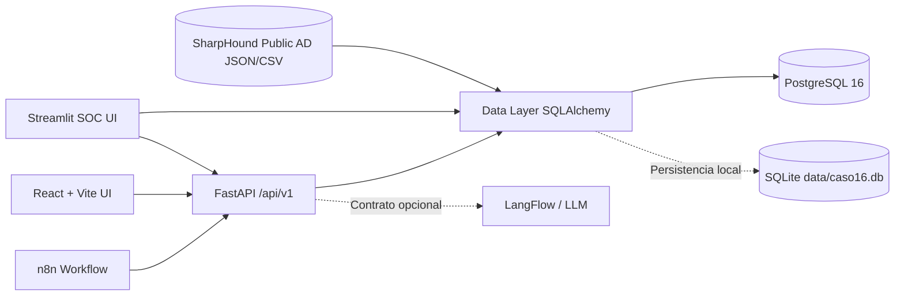

# 🛡️ CASO16 — Identity Risk AI

[](https://www.python.org/)
[](https://fastapi.tiangolo.com/)
[](https://streamlit.io/)
[](https://react.dev/)
[](https://www.postgresql.org/)
[](./LICENSE)

**Plataforma de detección determinista y gobierno de identidades para el descubrimiento de cuentas huérfanas, inactivas y privilegios excesivos sobre telemetría real de Active Directory.**

Este proyecto implementa un **sistema operacional auditable** diseñado para equipos SOC, administradores de seguridad y auditores de TI. Evalúa el dataset público de telemetría Active Directory **SharpHound / BloodHound** (`PHANTOM.CORP`, `WRAITH.CORP`, `GHOST.CORP` y `ESC1.LOCAL`) mediante un motor determinista de reglas (`R01`–`R06`) y scoring (`0–100`), exponiendo los resultados en una consola interactiva en **Streamlit**, una API REST versionada en **FastAPI**, una interfaz en **React + TypeScript (Vite)** y contratos listos para **n8n** y **LangFlow**.

---

## 📋 Tabla de Contenidos

- [Dataset Público y Resultados Reales de la Corrida](#-dataset-público-y-resultados-reales-de-la-corrida)
- [Características Principales](#-características-principales)
- [Arquitectura del Sistema](#-arquitectura-del-sistema)
- [Motor de Reglas y Scoring](#-motor-de-reglas-y-scoring)
- [Estructura del Proyecto](#-estructura-del-proyecto)
- [Requisitos Previos](#-requisitos-previos)
- [Instalación y Ejecución Rápida](#-instalación-y-ejecución-rápida)
  - [Opción 1: Entorno Local (Python)](#opción-1-entorno-local-python)
  - [Opción 2: Docker Compose + PostgreSQL](#opción-2-docker-compose--postgresql)
  - [Opción 3: Frontend React (Vite)](#opción-3-frontend-react-vite)
- [Referencia de la API REST](#-referencia-de-la-api-rest)
- [Pruebas y Verificación](#-pruebas-y-verificación)
- [Seguridad, Alcance y Cumplimiento](#-seguridad-alcance-y-cumplimiento)
- [Licencia](#-licencia)

---

## 📊 Dataset Público y Resultados Reales de la Corrida

El sistema incorpora e ingiere automáticamente volcados públicos de recolección **SharpHound / BloodHound Active Directory** ubicados en `data/` (`sharphound_20240305110018_*`, `sharphound_20240305110427_*`, `sharphound_20240305111414_*`, `bloodhound_*` y el consolidado `data/sharphound_public_dataset.csv`), abarcando **4 dominios de Active Directory**:

- `PHANTOM.CORP` (53 cuentas)
- `WRAITH.CORP` (40 cuentas)
- `ESC1.LOCAL` (14 cuentas)
- `GHOST.CORP` (6 cuentas únicas)

### Indicadores Globales Obtenidos (Corrida Real)

| Indicador (KPI) | Resultado Real | Detalle Técnico |
| :--- | :---: | :--- |
| **Cuentas de Directorio Auditadas** | **113** | Identificadas por su `ObjectIdentifier` (SID de Windows AD) |
| **Cuentas Inactivas / Huérfanas (`R01`)** | **81** | 24 con `inactive_days >= 90` confirmados + 57 con `lastLogon = 0` |
| **Cuentas de Riesgo Alto o Crítico** | **64** | Puntaje determinista `risk_score >= 60` |
| **Cuentas de Servicio sin Expiración (`R04`)** | **17** | Cuentas SPN / Servicio con `pwdNeverExpires = true` |
| **Hallazgos Totales Detectados** | **269** | **44 Críticos**, **107 Altos** y **118 Medios** (`117 confirmados` / `152 potenciales`) |
| **Riesgo Acumulado del Directorio** | **6,671 pts** | Suma de scores individuales (`0–100`) de las 113 identidades |

### Distribución de Hallazgos por Regla

| Regla | Nombre de la Regla | Severidad | Hallazgos Detectados | Estado de Evidencia |
| :---: | :--- | :---: | :---: | :---: |
| **`R01`** | Inactividad prolongada (`>= 90 días` o `lastLogon=0`) | Medio | **81** | Confirmado / Potencial |
| **`R02`** | Privilegio administrativo sin justificación en AD | Alto | **32** | Confirmado |
| **`R03`** | Cuenta administrativa duplicada en el dominio | Medio | **37** | Potencial |
| **`R04`** | Contraseña de cuenta de servicio no expira (`pwdNeverExpires`) | Alto | **17** | Confirmado |
| **`R05`** | Privilegios fuera de la línea base (`Domain Admins`, `Schema Admins`, etc.) | Crítico | **44** | Confirmado |
| **`R06`** | Riesgo elevado (`score >= 60`) sin revisión reciente (`pwdLastSet > 90d`) | Alto | **58** | Potencial |

---

## ✨ Características Principales

- **Ingesta de Telemetría Real AD/LDAP:** Procesamiento directo de objetos `users.json` y `groups.json` de SharpHound/BloodHound (`samaccountname`, `ObjectIdentifier` SID, `admincount`, `pwdneverexpires`, `hasspn`, `lastlogontimestamp`, `pwdlastset`, `description` y membresías de grupos).
- **Motor Determinista de Reglas (`R01`–`R06`):** Evaluación reproducible con distinción explícita entre evidencia **Confirmada** (`confirmed`) y **Potencial** (`potential`).
- **Scoring de Riesgo (`0–100`):** Cálculo transparente basado en privilegios administrativos, antigüedad de inactividad, cuentas de servicio/SPN, expiración de contraseñas y revisiones pendientes.
- **Gestión del Ciclo de Vida de Hallazgos:** Flujo completo (*Detectado → En evaluación → Asignado → En remediación → Pendiente de validación → Resuelto → Cerrado*) con asignación de propietario y comentarios.
- **Bitácora de Auditoría Inmutable (*Append-Only*):** Registro trazable de cada corrida de detección, cambio de estado y generación de reportes con fecha/hora UTC, actor y rol.
- **Exportación Ejecutiva Multiformato:** Generación nativa de reportes de auditoría en **Excel (`.xlsx`)**, **Word (`.docx`)** y **PDF (`.pdf`)** con los 269 hallazgos reales.

---

## 🏗️ Arquitectura del Sistema



---

## 🎯 Motor de Reglas y Scoring

| Código | Regla | Condición Técnica Evaluada | Severidad Base |
| :--- | :--- | :--- | :---: |
| **`R01`** | **Inactividad prolongada** | `lastLogon <= 0` (`potential`) o antigüedad `>= 90 días` respecto a la captura (`confirmed`). | Medio |
| **`R02`** | **Privilegio administrativo sin justificación** | `adminCount = true` o grupo administrativo sin atributo `description`/`title` en AD. | Alto |
| **`R03`** | **Cuenta administrativa duplicada** | Identidad administrativa adicional en el dominio distinta de la cuenta built-in `Administrator`. | Medio |
| **`R04`** | **Contraseña de servicio no expira** | Cuenta de servicio/SPN (`hasspn = true` o prefijo de servicio) con `pwdNeverExpires = true`. | Alto |
| **`R05`** | **Privilegios inconsistentes** | Membresía en grupos fuera de la política base (`Domain Users`, `Helpdesk`, `ReadOnly`, `Guests`). | Crítico |
| **`R06`** | **Riesgo alto sin revisión** | `risk_score >= 60` con `pwdLastSet` nulo o mayor a 90 días. | Alto |

---

## 📂 Estructura del Proyecto

```text
caso16-identity-risk-ai/
├── app.py                              # Consola SOC interactiva en Streamlit
├── main.py                             # API REST versionada (/api/v1) con FastAPI
├── data_layer.py                       # Ingesta SharpHound, modelo SQLAlchemy, motor R01-R06 y reportes
├── data/
│   ├── sharphound_public_dataset.csv   # Dataset público consolidado (113 cuentas AD reales)
│   ├── sharphound_*_users.json         # Volcados públicos de usuarios AD (PHANTOM, WRAITH, GHOST)
│   ├── sharphound_*_groups.json        # Volcados públicos de grupos AD
│   ├── bloodhound_users.json           # Volcado público BloodHound (ESC1.LOCAL)
│   ├── bloodhound_groups.json          # Grupos BloodHound (ESC1.LOCAL)
│   └── caso16.db                       # Base SQLite con las 113 cuentas y 269 hallazgos precalculados
├── requirements.txt                    # Dependencias de Python
├── Dockerfile                          # Imagen de contenedor para backend y UI
├── docker-compose.yml                  # Orquestación de PostgreSQL 16 + Streamlit + FastAPI
├── .env.example                        # Plantilla de variables de entorno
├── automation_n8n_scan.json            # Flujo exportable para escaneos programados en n8n
├── langflow_flow.json                  # Contrato de integración opcional con LangFlow
├── docs/
│   ├── ARCHITECTURE.md                 # Detalle arquitectónico y modelo de datos
│   ├── LIMITATIONS.md                  # Alcance del sistema y controles previos a producción
│   └── TRACEABILITY.md                 # Matriz de trazabilidad de requerimientos
├── frontend/                           # Interfaz web en React 18 + TypeScript + Vite
├── tests/
│   └── test_core.py                    # Pruebas unitarias e integración sobre las 113 cuentas
├── test_smoke.py                       # Smoke tests de base de datos, reglas y endpoints
├── test_reports.py                     # Verificación de generación de reportes XLSX/DOCX/PDF
├── test_ui.py                          # Pruebas de renderizado de la interfaz Streamlit
└── LICENSE                             # Licencia MIT
```

---

## 🔧 Requisitos Previos

- **Python:** `3.11` o superior
- **Node.js:** `18+` *(opcional, solo para compilar o ejecutar el frontend en `frontend/`)*
- **Docker & Docker Compose:** *(opcional, para despliegue con PostgreSQL 16)*

---

## 🚀 Instalación y Ejecución Rápida

### Opción 1: Entorno Local (Python)

1. **Clonar el repositorio:**
   ```bash
   git clone https://github.com/Prolexis/caso16-identity-risk-ai.git
   cd caso16-identity-risk-ai
   ```

2. **Crear y activar el entorno virtual:**
   ```powershell
   # Windows (PowerShell)
   py -3.11 -m venv .venv
   .\.venv\Scripts\Activate.ps1
   ```
   ```bash
   # Linux / macOS
   python3 -m venv .venv
   source .venv/bin/activate
   ```

3. **Instalar dependencias:**
   ```bash
   pip install -r requirements.txt
   ```

4. **Iniciar la consola SOC (Streamlit):**
   ```bash
   streamlit run app.py --server.port 8501
   ```
   - Accede en tu navegador a: **http://localhost:8501**
   - **Usuarios de demostración:**
     - `analyst@demo.local` *(Analista de ciberseguridad)*
     - `security@demo.local` *(Administrador de seguridad)*
     - `auditor@demo.local` *(Auditor)*
   - **Contraseña:** `demo`

5. **Iniciar la API REST (FastAPI):**
   ```bash
   uvicorn main:app --host 0.0.0.0 --port 8000 --reload
   ```
   - Documentación interactiva (Swagger UI): **http://localhost:8000/docs**

---

### Opción 2: Docker Compose + PostgreSQL

Para levantar el stack completo (**PostgreSQL 16 + Streamlit + FastAPI**):

```bash
docker compose up --build
```

- **Consola Streamlit:** `http://localhost:8501`
- **API FastAPI:** `http://localhost:8000/docs`
- **Base de datos:** PostgreSQL 16 con persistencia en el volumen `caso16_pgdata`

---

### Opción 3: Frontend React (Vite)

```bash
cd frontend
npm install
npm run dev
```

- Accede en: `http://localhost:5173`

---

## 🔌 Referencia de la API REST

Todos los endpoints están bajo el prefijo `/api/v1`:

| Método | Endpoint | Descripción |
| :---: | :--- | :--- |
| `GET` | `/api/v1/health` | Estado del servicio, base de datos conectada y total de cuentas cargadas (`113`). |
| `GET` | `/api/v1/dashboard` | KPIs reales del dataset público (`113` cuentas, `81` inactivas, `269` hallazgos). |
| `GET` | `/api/v1/accounts` | Lista paginada y filtrable (`?search=...&limit=100`) del inventario de identidades AD. |
| `GET` | `/api/v1/findings` | Lista de los 269 hallazgos filtrable por estado (`?status=Detectado`) y severidad (`?severity=Crítico`). |
| `POST` | `/api/v1/scans` | Ejecuta una corrida completa del motor determinista (`R01`–`R06`) y registra auditoría. |
| `PATCH` | `/api/v1/findings/{id}` | Actualiza el estado, responsable (`owner`) y comentario de un hallazgo con trazabilidad en `audit_logs`. |

---

## 🧪 Pruebas y Verificación

```bash
python -m unittest discover -s tests -v
python test_smoke.py
python test_reports.py
python test_ui.py
```

---

## 🔒 Seguridad, Alcance y Cumplimiento

- **Modo de Solo Lectura / No Destructivo:** Opera sobre volcados públicos de auditoría Active Directory (SharpHound/BloodHound) y **no ejecuta acciones destructivas** sobre directorios productivos.
- **Privacidad ante IA:** Ningún secreto, hash o credencial se envía a modelos externos.
- **Referencia Normativa (ISO/IEC 27001 — Controles A.8.2 y A.8.16):** El diseño de las reglas y la bitácora de auditoría está alineado con la gestión de derechos de acceso privilegiado y monitoreo de actividades.

---

## 📄 Licencia

Distribuido bajo la licencia **MIT**. Consulta el archivo [`LICENSE`](./LICENSE) para más detalles.
