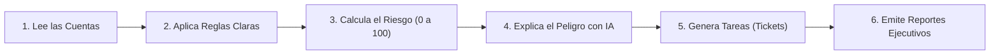

# 🛡️ CASO16 — Identity Risk AI
## ¿En qué consiste este proyecto y para qué sirve?

---

### 1. En pocas palabras: ¿Qué es este proyecto?

Imagina que una gran empresa es como un edificio corporativo con cientos de puertas, oficinas y cajas fuertes. Cada empleado y cada sistema informático tienen una "llave digital" (un usuario y una contraseña) para ingresar.

Con el paso de los años suceden situaciones comunes:
- Empleados que renuncian o se van de la empresa, pero **nadie les canceló sus llaves** (quedan activas en el sistema).
- Personas que cambiaron de puesto y acumularon **permisos de administrador que ya no necesitan**.
- Sistemas automáticos cuyas claves **nunca caducan** y nadie vigila.

**CASO16 — Identity Risk AI** es como un **auditor de seguridad inteligente y automático**. Su misión es revisar minuciosamente todas las "llaves y accesos" de la empresa (el Directorio Activo corporativo) para descubrir cuáles están abandonadas, cuáles tienen poderes excesivos y alertar al equipo de seguridad antes de que un ciberdelincuente las use para entrar a robar información.

---

### 2. ¿Qué problema resuelve en el mundo real?

En la mayoría de los ciberataques y secuestros de datos (*ransomware*) que sufren las empresas, los atacantes **no rompen las defensas con magia**: simplemente encuentran una **cuenta olvidada** o de un exempleado, adivinan su clave y, como esa cuenta tenía permisos de administrador, toman el control de toda la red.

Este proyecto resuelve 5 grandes peligros:
1. **Cuentas Huérfanas / Inactivas:** Usuarios que llevan más de 3 meses sin iniciar sesión pero siguen activos.
2. **Administradores Ocultos:** Cuentas con permisos de control total sin ninguna justificación documentada.
3. **Cuentas Duplicadas:** Accesos paralelos que dificultan saber quién hizo qué.
4. **Cuentas de Servicio sin Expiración:** Claves de programas que nunca cambian y son presa fácil de ataques.
5. **Falta de Trazabilidad:** No saber quién revisa los problemas ni cuánto tardan en corregirse.

---

### 3. ¿Para qué sirve y qué hace el sistema?

El sistema realiza todo el ciclo de protección de identidades de forma automática:

1. **Escaneo Automático:** Examina las cuentas reales de la red corporativa en segundos.
2. **Evaluación Transparente:** Evalúa 6 reglas de ciberseguridad conocidas en la industria (sin inventar datos ni usar cajas negras).
3. **Puntuación de Riesgo (0 a 100):** Asigna una calificación a cada usuario: mientras más alto el puntaje, más urgente es atender esa cuenta.
4. **Asistente Inteligente (IA):** Para cada problema encontrado, explica en español claro:
   - *¿Por qué es peligroso?*
   - *¿Cómo podría aprovecharlo un atacante?*
   - *¿Qué pasos exactos debe seguir el técnico para solucionarlo hoy mismo?*
5. **Gestión de Tareas (Tickets y SLA):** Crea solicitudes de trabajo asignadas a responsables, con una fecha límite de atención (ejemplo: 7 días para riesgos críticos).
6. **Reportes para Gerencia y Auditores:** Con un solo clic genera informes ejecutivos listos para imprimir o presentar en **PDF**, **Word (.docx)** y **Excel (.xlsx)**.

---

### 4. ¿Con qué datos trabaja actualmente?

El proyecto no utiliza datos ficticios o inventados. Trabaja con telemetría real de ciberseguridad correspondiente a **4 dominios corporativos**:

| Indicador Clave | Valor Real | ¿Qué significa para el negocio? |
| :--- | :---: | :--- |
| **Cuentas Auditadas** | **113** | El total de usuarios y sistemas analizados. |
| **Cuentas Inactivas / Huérfanas** | **81** | Usuarios sin uso que deberían suspenderse de inmediato. |
| **Cuentas en Riesgo Alto / Crítico** | **64** | Accesos con privilegios peligrosos que requieren revisión urgente. |
| **Cuentas de Servicio con Clave Eterna** | **17** | Sistemas vulnerables a ataques de extracción de claves. |
| **Problemas Detectados (Hallazgos)** | **269** | Puntos débiles concretos identificados con evidencia. |

---

### 5. Beneficios para la Empresa

- **Ahorro de Tiempo:** Lo que a un auditor humano le tomaría semanas revisando hojas de cálculo, el sistema lo hace en segundos.
- **Prevención Real de Ciberataques:** Cierra las puertas traseras antes de que los hackers las descubran.
- **Cumplimiento de Normas Internacionales:** Ayuda a cumplir estándares globales de seguridad de la información como **ISO/IEC 27001 (Control A.8.2)**.
- **Tranquilidad para la Gerencia:** Tableros visuales claros con semáforos de riesgo y reportes formales descargables para auditoría.
