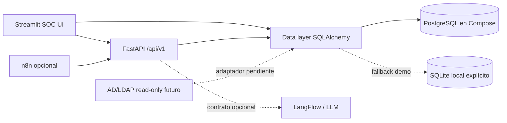

# Arquitectura CASO16 (MVP)

El motor determinista es la fuente de verdad para las evidencias y el score. Un modelo LLM, cuando se configure, solo puede explicar/priorizar y debe registrar modelo, prompt, ejecución y validación. Las integraciones externas están preparadas como contratos, no declaradas como conectadas.

Entidades implementadas en el MVP: `directory_accounts`, `findings`, `detection_runs` y `audit_logs`. La ampliación empresarial debe añadir usuarios/RBAC persistente, fuentes, grupos, membresías, tickets, reportes y excepciones con migraciones Alembic.
